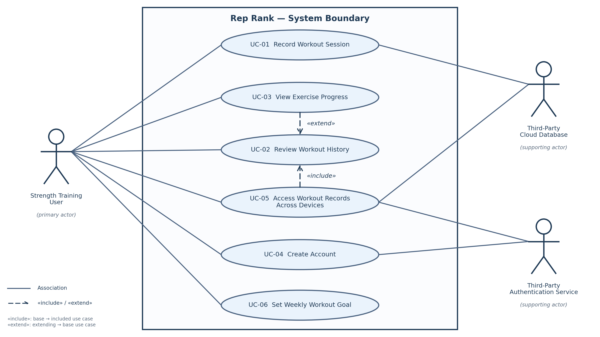

# P1 Contributions — Anshika

**Project:** Rep Rank  
**Course:** CS 3354  
**Milestone:** P1 — Proposal and Requirements

This file documents my contributions to the team's shared Microsoft Word proposal.

## Section 3.4 — Initial Use Cases

 
Expanded use case  —  copy this block for each of your two 

Field 

Content 

Identifier and name 

UC-01  - Record Workout Session 

Primary actor 

Strength Training User 

Supporting actors 

Third-party cloud database, when cloud storage is enabled 

Preconditions — what must be true before it starts 

The user has opened the application and has access to the workout logging feature. 

Trigger — what starts it 

The user chooses to record a workout session. 

Main success scenario — numbered steps 

The user opens the workout logging feature.  

 The system displays an exercise search bar.  

The user searches for and selects an exercise.  

The system displays the user's most recent recorded performance for that exercise, if available.  

The user enters the weight, number of sets, and repetitions performed.  

The user saves the workout entry.  

The system stores the exercise log in the user's workout history.  

The system confirms that the entry was saved successfully. 

Alternative and exception flows 

A1: If the exercise search returns no matches, the system informs the user and allows another search.  

A2: If the exercise has no previous records, the system allows the user to continue without displaying past performance.  

 

E1: If required workout information is missing or invalid, the system requests corrections before saving.  

E2: If saving fails, the system informs the user that the workout was not saved and allows for another attempt. 

Postconditions — what is true when it succeeds 

The workout entry is saved in the user's workout history and can be retrieved in a later application session. 

Requirements realised 

FR-01, FR-02, FR-03, FR-10 

 

Field 

Content 

Identifier and name 

UC-05 — Access Workout Records Across Devices 

Primary actor 

Strength Training User 

Supporting actors 

Third-party authentication service and third-party cloud database 

Preconditions — what must be true before it starts 

The user has an existing account with previously saved workout records. The application is installed on another supported device. 

Trigger — what starts it 

The user opens Rep Rank on another device to access their saved workout records. 

Main success scenario — numbered steps 

1. The user opens the application on the second device.  

2. The user selects the account sign-in option.  

3. The system requests the user's account credentials.  

4. The user submits their credentials.  

5. The system requests authentication through the third-party authentication service.  

6. The authentication service verifies the credentials.  

7. The system retrieves the workout records associated with the user's unique account identifier from cloud storage.  

8. The system displays the user's previously recorded workouts. 

Alternative and exception flows 

A1: If the credentials are incorrect, the system displays an authentication error and allows the user to retry.  

A2: If no previous workout records exist, the system displays an empty workout history. 

 

E1: If the authentication service is unavailable, the system informs the user that sign-in cannot be completed.  

E2: If the cloud database is unavailable, the system informs the user that workout records cannot currently be retrieved.  

Postconditions — what is true when it succeeds 

The user is authenticated and can access workout records associated with their account on the second device. 

Requirements realised 

FR-08, FR-09 

## Section 3.5 — Requirements Traceability

Requirement ID 

Use case(s) that realize it 

If blank — why, and what you will do 

FR-01 

UC-01 

 

FR-02 

UC-01, UC-02 

 

FR-03 

UC-01 

 

FR-04 

UC-03 

 

FR-05 

UC-06 

 

FR-06 

 

None 

Competitive leaderboards are excluded from the initial release in Section 1.2. Confirm whether this requirement will be deferred to a future release. 

FR-07 

 

UC-04 

 

FR-08 

 

UC-05  

 

FR-09 

 

UC-05 

 

FR-10 

 

UC-01 

 

The matrix traces nine of the ten functional requirements to at least one of the six use cases. FR-06 is the only requirement with no use case, for the reason given in its row. UC-06 (Set Weekly Workout Goal) was added so that FR-05 has a use case. Every use case traces to at least one functional requirement (see the use case summary in Section 3.4), so no use case is left without a requirement. 

The matrix also shows three things. FR-02 is realized in two use cases: UC-01 saves the log, and UC-02 retrieves it. FR-08 and FR-09 trace only to UC-05, so UC-05 carries both sign-in and cross-device access. FR-07, FR-08 and FR-09 all depend on cloud storage and must be delivered together (note in Section 3.1), and they trace to UC-04 and UC-05, the two use cases that use the third-party authentication service. If the cloud features are cut, these two use cases are cut together. 

## Section 4.3 — Project Risks

# 

Risk 

Likelihood 

Impact 

Mitigation — action and owner 

R1 

Team members may miss deadlines for assigned tasks 

Moderate 

High 

David Wittler: Assign a deadline to every GitHub issue, review task progress twice per week, and reassign overdue tasks at the next team meeting. 

R2 

Third-party authentication or cloud database integration may fail or take longer than expected 

Moderate 

High 

Anshika Anshika: By 11/01/2026, one week after the provider decision in Q1 is due, build an early integration prototype that creates a test account, signs in, saves a workout record, and retrieves it from the cloud database. Document integration errors and create GitHub issues for unresolved problems. 

R3 

Workout records may be lost, incorrectly saved, or associated with the wrong user 

Moderate 

High 

Laxmi Akshaya Komaragiri: Write and run tests for saving and retrieving workout records, including tests that confirm records stay associated with the correct user account, before the P2 submission on 11/08/2026. 

R4 

The application may behave differently across iOS and Android devices 

Moderate  

Moderate 

Veda Manchana: Test the main application features using both iOS and Android development environments and record compatibility issues in GitHub. 

R5 

Additional features or changing requirements may cause the project to exceed its planned scope 

High 

High 

Shreya Singaravel Sabapathi: Compare proposed features against the approved scope in Section 1.2. Document requested changes in GitHub and obtain team approval before adding new features to the development plan. 
