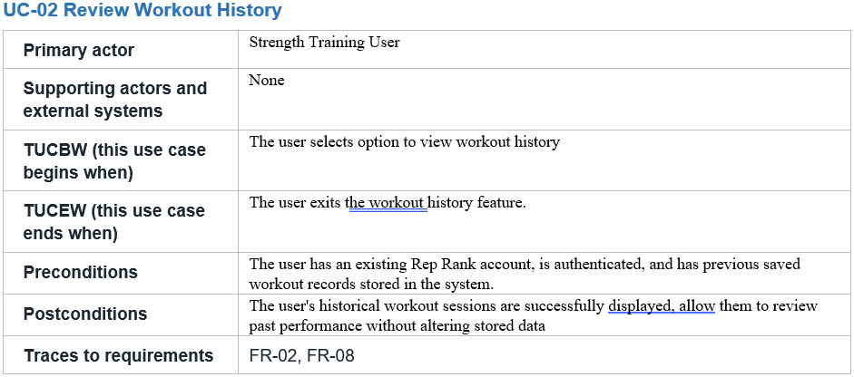
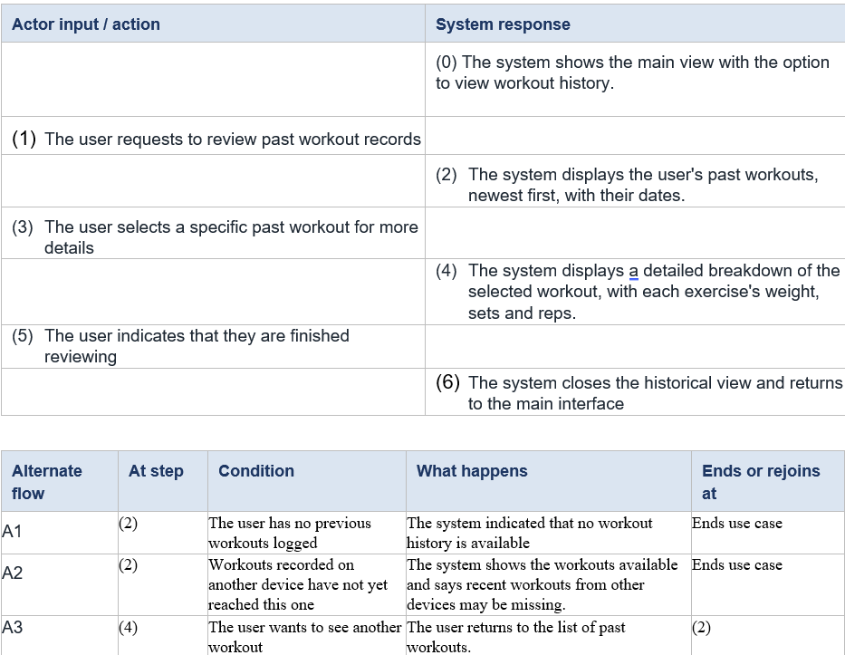

# P2 Contributions - Anshika

Author: Anshika

## Section 4.1 Use cases selected for analysis (revised from Laxmi's draft)

### Changes and reasons

1. **Removed technology from "Why selected" and "Non-trivial steps".** The draft named Supabase, Row Level Security, JWT sessions, relational tables and server-side database functions. Section 4 is analysis with the technology switched off: the P2 rubric awards full marks only for use cases with "no technology", and the template's Lesson 13 rules reject database and framework names. Technology decisions belong in sections 6 and 7.
2. **Replaced the "Non-trivial steps" column with step numbers from 4.2.** The template defines non-trivial steps as the steps in 4.2 that need objects inside the system.
**Restored the P1 use-case names.**
**Gave UC-02 a reason based on user evidence.**

## Section 4.2 Expanded use cases (revised from Laxmi's drafts)
### UC-01 Record Workout Session

### UC-05 Access Workout Records Across Devices

### UC-02 Review Workout History

### Changes and reasons (4.2)

**UC-01**
- Added step (0) and numbered all rows as required by the rubric.
- Split "search and select"; merged "enter" and "save": one turn per row.
- Removed cloud saving; supporting actors set to None: background work and technology don't belong in analysis.
- Replaced "search bar" as a screen widget is technology.
- Filled traces (FR-01, FR-02, FR-03, FR-10)

**UC-05**
- Added step (0); removed the "opens the app" row: that row is the trigger (TUCBW).
- Expanded step (4) with verification and retrieval: the user waits for both, and 5.2 needs them.
- Moved "network access" from preconditions to A4: it can be false during normal use.
- Added A3, A5, A6 and traces QR-01, CON-02

**UC-02**
- Removed "has saved records" from preconditions: it contradicted A1.
- TUCBW reduced to one action; supporting actors set to None: the user is already signed in.
- Removed "home screen interface" and "cached locally": technology.
- Step (2) now shows the list: every system turn must be visible to the user.
- Traces changed to FR-02, FR-08: matches the P1 matrix.

### Changes and reasons (4.3)
- New section: the rubric requires a self-review log of what each Lesson 13 check found and fixed.
- Lists actor-column items for the domain model so cross-check K1 can run.

## Section 10.3 Risks (updated)

## Section 10.4 Repository

## Section 0.2 

