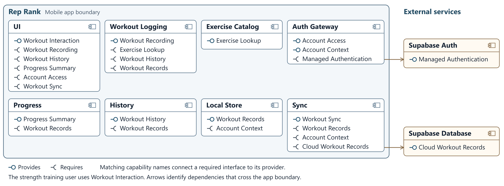
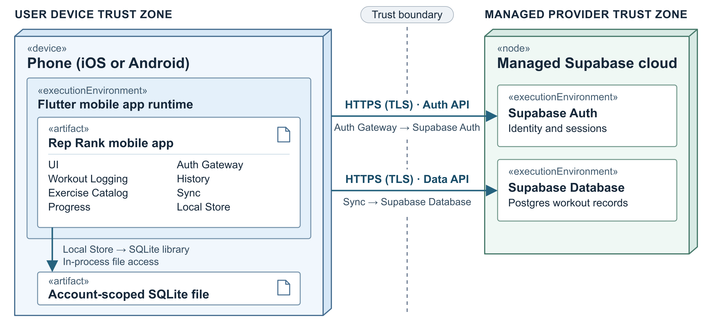

## 6.3 Component view

*Figure 6.3. Rep Rank components, provided and required interfaces, and external services.*

| Component | Responsibility | Provides | Requires | Answers to |
| --- | --- | --- | --- | --- |
| UI | Presents workout, progress and account flows and their results. | Workout Interaction | Workout Recording, Workout History, Progress Summary, Account Access, Workout Sync | UC-01, UC-02, UC-03, UC-04, UC-05, ADR-04 |
| Workout Logging | Validates entries, reads prior performance and confirms local saves. | Workout Recording | Exercise Lookup, Workout History, Workout Records | UC-01, ADR-02 |
| Exercise Catalog | Searches the bundled exercises by name. | Exercise Lookup | None | UC-01 |
| Progress | Calculates dated estimated 1RM values using FR-04. | Progress Summary | Workout Records | UC-03 |
| History | Lists sessions newest first and returns details and the latest entry by exercise. | Workout History | Workout Records | UC-01, UC-02, UC-05 |
| Local Store | Saves workouts and pending sync state in account-scoped SQLite. | Workout Records | Account Context | UC-01, UC-02, UC-05, ADR-02 |
| Sync | Exchanges account records with the cloud and reports sync status. | Workout Sync | Workout Records, Account Context, Cloud Workout Records | UC-05, ADR-02, ADR-03 |
| Auth Gateway | Handles registration and sign-in and provides verified account context. | Account Access, Account Context | Managed Authentication | UC-04, UC-05, QAS-02, ADR-03 |
| Supabase Auth (external) | Verifies credentials and issues sessions. | Managed Authentication | None | UC-04, UC-05, QAS-02, ADR-03 |
| Supabase Database (external) | Stores workouts and enforces account isolation via row-level security. | Cloud Workout Records | None | UC-05, QAS-02, ADR-03 |

Workout Logging confirms a save after Local Store commits the entry with its pending sync state. Sync exchanges records when the session is valid and the device is online. On a second device, the UI requests sync after sign-in, then reads imported records through History. If sync fails, the UI indicates that local results may be out of date.

## 6.4 Deployment view

*Figure 6.4. Rep Rank deployment on the phone and in the managed Supabase project.*

| Node | What runs on it | Communicates with and how | Trust zone |
| --- | --- | --- | --- |
| iOS or Android phone | Flutter runtime and Rep Rank app artifact containing all eight internal components. The app sandbox contains the account-scoped SQLite file. | Auth Gateway to Supabase Auth via HTTPS/TLS. Sync to the Supabase Data API via HTTPS/TLS. Local Store accesses the SQLite file through the in-process SQLite library. | User device and app sandbox |
| Managed Supabase project | Supabase Auth, the Data API and Postgres (Supabase Database). | Accepts the phone’s two HTTPS/TLS connections. The Data API applies the account session to database requests. | Provider-managed cloud |

Supabase operates the hosted services. The Rep Rank team configures and tests Postgres row-level security (RLS) for every exposed workout table, scopes local reads and writes to the verified account and protects session material on the phone. The app uses a publishable key with the user’s session. Privileged keys belong in restricted server-side configuration. The team decides what it collects and retains, limiting cloud data to the account and workout fields required by the use cases. [Shared responsibility](https://supabase.com/docs/guides/deployment/shared-responsibility-model) · [Row-level security](https://supabase.com/docs/guides/database/postgres/row-level-security) · [API keys](https://supabase.com/docs/guides/getting-started/api-keys)

## 6.5 From analysis to architecture

| Analysis object from 5.1 or 5.2 | Owning component in 6.3 | Mapping note |
| --- | --- | --- |
| Exercise | Exercise Catalog | Supplies named exercises for selection. |
| Exercise Entry | Workout Logging | Creates and validates entries. Progress derives 1RM from their values. |
| Session / Workout Session | Workout Logging | Same domain object. Workout Logging assembles its entries, and Local Store persists it. |
| User | Auth Gateway | Owns the app’s account identity. Supabase Auth handles password verification. |
| Account | Auth Gateway | Represents the signed-in User identity on the current device. |
| Workout Logging Controller | Workout Logging | Coordinates lookup, prior performance, validation and saving. |
| Exercise Catalog | Exercise Catalog | Realizes the analysis lookup through Exercise Lookup. |
| Workout History | History | Owns history reads. Workout Logging and Sync write through Local Store. |
| Sign-In Controller | UI | Coordinates Account Access, Workout Sync and Workout History for UC-05. |
| Authentication Service | Supabase Auth (external) | Implements credential verification through Managed Authentication. |
| Cloud Database | Supabase Database (external) | Supplies account-scoped records through Cloud Workout Records. |

The Strength Training User is an external actor and uses the UI’s Workout Interaction interface.

## 6.6 Design principles applied

| Principle | Where it shows in the design | Evidence |
| --- | --- | --- |
| Separation of concerns | Workout Logging confirms the local save while Sync handles later cloud transfer. | Workout Recording, Workout Sync, ADR-02 |
| Information hiding | Auth Gateway encapsulates the provider’s sign-in and token verification details. | Account Access, Account Context |
| Low coupling | History reads Workout Records through Local Store and has no dependency on Supabase. | Workout History, Workout Records |
| High cohesion | Progress owns estimated 1RM calculation and the dated series for the selected exercise. | Progress Summary, UC-03 |
| Design for change | Sync can adapt to a different cloud records API while History keeps reading Workout Records. | Cloud Workout Records, Workout Records, ADR-03 |
| Keep it simple (KISS) | The app uses one on-device workout store and sends cloud requests to the managed services. | Local Store, Supabase Database, ADR-01 |
